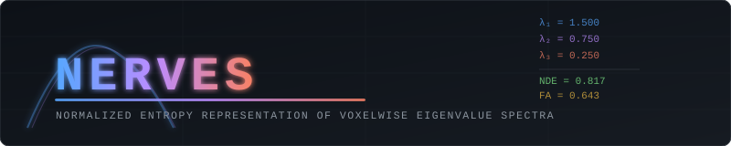

<div align="center">



# NERVES
### Normalized Entropy Representation of Voxelwise Eigenvalue Spectra

[](https://www.python.org/)
[](LICENSE)
[](https://doi.org/10.5281/zenodo.19738588)
[](https://fsl.fmrib.ox.ac.uk/)
[](https://www.mrtrix.org/)

**Tensor-fit QC and scalar-reliability tools for diffusion MRI, plus a pipeline for Normalized Diffusion Entropy (NDE) and tensor-shape maps.**

[Reliability & QC](#reliability--qc-tools) · [Installation](#installation) · [Quick Start](#quick-start) · [Documentation](#documentation) · [Citation](#citation)

</div>

---

## Overview

NERVES provides an end-to-end pipeline for computing **Normalized Diffusion Entropy (NDE)** maps from raw diffusion-weighted MRI data. NDE is the Shannon entropy of the (normalised) diffusion tensor eigenvalue spectrum.

### What NDE is — and is not

> **Scope note.** NDE is a *scalar summary of the three tensor eigenvalues*. It is
> **not** the model-free (Q-ball / mean-free-path) diffusion entropy of
> Fozouni et al. 2013, which is cited as related work on entropy-based diffusion
> contrast but uses a different estimator and sign convention.

Because NDE depends only on the eigenvalue *shape*, it is a deterministic function of
two orthogonal tensor invariants, FA and tensor mode (Ennis & Kindlmann 2006). In
simulation (see `tests/test_complementarity.py`) NDE correlates with FA at about
r ≈ −0.94, FA alone explains ≈ 98 % of NDE variance, and FA + mode explain > 99.9 %.
Practically:

- At **fixed FA**, NDE still varies with how the minor eigenvalues split (λ₂ vs λ₃),
  i.e. with tensor mode. That is the only information NDE adds to FA.
- Tensor mode captures that same information directly and has an established
  interpretation. In a Monte-Carlo simulation (SNR 25, 30 directions, b = 1000;
  `validation/noise_simulation.py`) mode separated two voxel populations that
  differ only in the λ₂/λ₃ split roughly **9–10× better** than NDE (d′ 3.3 vs 0.36),
  while for FA-like changes NDE and FA performed alike. NERVES therefore writes
  **tensor mode (and Westin shape indices) alongside NDE** by default (`--nde_only`
  to disable).
- Claims that NDE is more sensitive than FA to Wallerian degeneration, crossing
  fibres, etc. are **hypotheses, not results of this repository**: no clinical or
  phantom validation data are included. Treat NDE as an exploratory metric.
- Like FA, NDE is biased by noise (eigenvalue sorting inflates λ₁ and deflates λ₃),
  so low-SNR acquisitions will shift values.

### Mathematical Definition

For eigenvalues λ₁ ≥ λ₂ ≥ λ₃ > 0 at each voxel, define normalised proportions:

$$p_i = \frac{\lambda_i}{\lambda_1 + \lambda_2 + \lambda_3}$$

Shannon entropy of the distribution:

$$H = -\sum_{i=1}^{3} p_i \ln(p_i)$$

Normalised to [0, 1]:

$$\text{NDE} = \frac{H}{\ln(3)}$$

- **NDE = 1** → perfectly isotropic (λ₁ = λ₂ = λ₃)  
- **NDE → 0** → maximally anisotropic (all diffusion along one eigenvector)
- **NDE = NaN** → undefined: at least one eigenvalue ≤ 0 (flagged in `nde_qc_flag.nii.gz`)

---

## Reliability & QC tools

New in v2. Both need only Python (NumPy, SciPy, nibabel), no FSL or MRtrix3. Details in
[docs/reliability.md](docs/reliability.md).

**1. `nerves_qc.py` — is this subject's tensor fit trustworthy?** Reads tensor maps you
already have (QSIRecon DSI Studio / TORTOISE / DIPY workflows, or NERVES/FSL `dti_*`
outputs) and reports non-physical voxels, FA saturation, MD plausibility, MD/AD/RD
consistency, expected error at the subject's SNR, and group outliers (robust z-scores).
Writes TSV, JSON and an HTML report.

```bash
python nerves_qc.py /path/to/derivatives --snr 20 --dirs 30 --b 1000
```

**2. `nerves_reliability.py` — how much can FA, MD, mode and NDE be trusted at this SNR?**
Monte-Carlo (Rician noise, the pipeline's own tensor fit) for protocol planning:

```bash
python nerves_reliability.py --sweep-snr 10 20 40 --tissue GM
python nerves_reliability.py --required FA:0.03 --tissue GM
```

Key findings at 30 directions, b = 1000 (OLS): FA in low-FA tissue is biased upward at
low SNR (GM-like FA 0.19 reads +0.087 at SNR 10; WM shows no bias); MD is essentially
unbiased; tensor mode has a voxelwise SD of 0.3–0.6 in low-FA tissue even at SNR 40, so
it should not be interpreted there. Reaching |bias|, SD ≤ 0.03 in FA needs SNR ≈ 40 in
GM-like tissue versus ≈ 25 in WM. These are simulation results with a single tissue
tensor, not in-vivo measurements.

---

## Pipeline Overview

```
Raw DWI + T1
     │
     ├── DWI Preprocessing
     │     ├── MP-PCA denoising       (MRtrix3: dwidenoise)
     │     ├── Gibbs ringing removal  (MRtrix3: mrdegibbs)
     │     ├── Brain masking          (FSL: bet)
     │     ├── Susceptibility corr.   (FSL: topup, optional)
     │     └── Eddy/motion correction (FSL: eddy)
     │
     ├── T1 Preprocessing
     │     ├── Brain extraction       (FSL: bet)
     │     ├── Tissue segmentation    (FSL: fast)
     │     └── Registration → DWI    (FSL: flirt 6-DOF, or ANTs rigid+affine)
     │
     ├── Tensor Estimation            (FSL: dtifit)
     │
     ├── NDE Computation              (Python/NumPy — native)
     │     └── Shape maps: tensor mode, Westin cl/cp/cs
     │
     └── QC + Report
           ├── Metric histograms
           ├── Tissue-specific distributions
           ├── NDE vs FA scatter
           ├── Axial slice montage
           └── JSON summary report
```

---

## Installation

### Prerequisites

| Dependency | Version | Purpose |
|---|---|---|
| [FSL](https://fsl.fmrib.ox.ac.uk/fsl/fslwiki/FslInstallation) | ≥ 6.0 | Preprocessing, tensor estimation |
| [MRtrix3](https://www.mrtrix.org/download/) | ≥ 3.0.3 | Denoising, Gibbs removal |
| Python | ≥ 3.8 | NDE computation, QC |
| [ANTs](https://github.com/ANTsX/ANTs) | ≥ 2.3 | Optional: improved T1→DWI registration |

### Python Environment

```bash
# Clone the repository
git clone https://github.com/TravisBeckwith/NERVES.git
cd NERVES

# Create and activate a virtual environment (recommended)
python -m venv nerves_env
source nerves_env/bin/activate        # Linux/macOS
# nerves_env\Scripts\activate         # Windows

# Install Python dependencies
pip install -r requirements.txt
```

### Verify Installation

```bash
python nde_pipeline.py --help
```

You should see the full argument list. If FSL or MRtrix3 tools are missing from PATH, an informative error will be raised before any processing begins.

---

## Quick Start

### Full Pipeline (Raw Data)

```bash
python nde_pipeline.py \
    --dwi  sub-01_dwi.nii.gz \
    --bval sub-01_dwi.bval   \
    --bvec sub-01_dwi.bvec   \
    --t1   sub-01_T1w.nii.gz \
    --out  ./sub-01_nerves   \
    --pe_dir AP
```

### With Susceptibility Distortion Correction

```bash
python nde_pipeline.py \
    --dwi    sub-01_dwi.nii.gz \
    --bval   sub-01_dwi.bval   \
    --bvec   sub-01_dwi.bvec   \
    --t1     sub-01_T1w.nii.gz \
    --rpe_b0 sub-01_b0_PA.nii.gz \
    --pe_dir AP \
    --out    ./sub-01_nerves
```

### Skip Preprocessing (Pre-computed Eigenvalues)

If you already have DTI eigenvalue maps (e.g., from FSL `dtifit`):

```bash
python nde_pipeline.py \
    --skip_preproc \
    --l1   dti_L1.nii.gz \
    --l2   dti_L2.nii.gz \
    --l3   dti_L3.nii.gz \
    --mask brain_mask.nii.gz \
    --dwi x --bval x --bvec x --t1 x \
    --out  ./nerves_output
```

### Already-preprocessed DWI (e.g. HCP-style) — no FSL needed

```bash
python nde_pipeline.py \
    --skip_dwi_preproc --tensor_fit python --wls \
    --dwi dwi.nii.gz --bval dwi.bval --bvec dwi.bvec \
    --mask brain_mask.nii.gz --max_b 1500 --out ./nerves_out
```

Adding `--t1 T1w.nii.gz` enables tissue-specific QC (needs FSL for BET/FAST/FLIRT).

### Recommended options for noisy or multi-shell data

```bash
python nde_pipeline.py ... --wls --max_b 1500 --min_snr 10 --resume --n_threads 8
```

### BIDS dataset

```bash
python nerves_bids.py /data/bids --participant-label 01 02 -- --wls --resume
python nerves_group_summary.py /data/bids/derivatives/nerves   # one CSV for all runs
```

### Registration options (rigid + affine ANTs, or boundary-based epi_reg)

```bash
python nde_pipeline.py \
    --dwi  sub-01_dwi.nii.gz \
    --bval sub-01_dwi.bval   \
    --bvec sub-01_dwi.bvec   \
    --t1   sub-01_T1w.nii.gz \
    --out  ./sub-01_nerves   \
    --registration ants      # or: --registration epi_reg (FSL boundary-based)
```

---

## Output Structure

```
sub-01_nerves/
├── preproc/
│   ├── dwi_denoised.mif          # MP-PCA denoised DWI
│   ├── dwi_degibbs.mif           # Gibbs-corrected DWI
│   ├── dwi_eddy.nii.gz           # Eddy-corrected DWI
│   ├── mean_b0_final_brain.nii.gz
│   ├── mean_b0_final_brain_mask.nii.gz
│   └── snr_map.nii.gz            # mean b0 / dwidenoise sigma (approximate)
├── t1/
│   ├── T1_brain.nii.gz
│   ├── T1_fast_pve_0.nii.gz      # CSF partial volume
│   ├── T1_fast_pve_1.nii.gz      # GM partial volume
│   ├── T1_fast_pve_2.nii.gz      # WM partial volume
│   └── T1_pve_*_DWIspace.nii.gz  # PVEs registered to DWI space
├── tensor/
│   ├── dti_L1.nii.gz             # λ₁ (axial diffusivity)
│   ├── dti_L2.nii.gz             # λ₂
│   ├── dti_L3.nii.gz             # λ₃
│   ├── dti_FA.nii.gz             # Fractional anisotropy
│   ├── dti_MD.nii.gz             # Mean diffusivity
│   └── dti_RD.nii.gz             # Radial diffusivity = (λ₂+λ₃)/2
├── nde/
│   ├── nde.nii.gz                # ★ NDE map (NaN where undefined)
│   └── nde_qc_flag.nii.gz        # 1 = non-physical eigenvalues, 2 = SNR < --min_snr
├── shape/
│   ├── mode.nii.gz               # Tensor mode (−1 planar … +1 linear)
│   └── cl / cp / cs .nii.gz      # Westin linear / planar / spherical
├── qc/
│   ├── qc_histograms.png         # NDE / FA / MD distributions in WM
│   ├── qc_tissue_distributions.png  # NDE by tissue class
│   ├── qc_nde_fa_scatter.png     # NDE vs FA scatter plot
│   └── qc_axial_montage.png      # Axial slice comparison
└── nde_pipeline_report.json      # Full QC statistics and thresholds
```

---

## QC Thresholds

NERVES applies the following automated sanity checks and records them in the JSON report.
They are coarse screens, **not** validated quality criteria; always inspect the QC figures.

| Metric | Expected | Interpretation if failed |
|---|---|---|
| Non-physical eigenvalue rate | < 5% (exit code 2 otherwise) | Tensor fitting or masking issue (try `--wls`) |
| CSF mean NDE (`csf_nde_pass`) | ≥ 0.90 | Registration / segmentation / tensor fit problem |
| Tissue ordering (`tissue_ordering_pass`) | mean NDE CSF > GM > WM | Registration / segmentation / tensor fit problem |

The NDE–FA Pearson r and absolute WM mean NDE are **reported for information only**.
NDE and FA are computed from the same eigenvalues, so they stay strongly anticorrelated
even for badly corrupted tensors, and absolute WM NDE depends on b-value, SNR,
resolution and how WM is defined.

---

## Validation

Claims about NDE should be tested, not assumed. The repository ships the tools:

| Tool | What it answers |
|---|---|
| `python validation/noise_simulation.py` | How do NDE, FA, MD and tensor mode behave versus SNR, and how well does each detect three kinds of tissue change? |
| `python validation/make_phantom.py --out DIR` | Synthetic DWI with known tensors, used by the end-to-end tests |
| `python validation/retest_reliability.py manifest.csv` | ICC and within-subject CV on your own test-retest data |

Current simulation results (OLS fit, SNR 25; d′ = separation of the two populations,
higher is better) — **NDE adds little over FA and is much less sensitive than tensor
mode to λ₂/λ₃ changes**:

| Scenario | FA | MD | NDE | Mode |
|---|---|---|---|---|
| A: same FA and trace, different λ₂/λ₃ split | 0.01 | 0.01 | 0.36 | **3.32** |
| B: symmetric radial diffusivity increase | **3.18** | 1.12 | 3.09 | 0.39 |
| C: λ₂/λ₃ redistribution, similar trace | 0.06 | 0.01 | 0.16 | **1.55** |

NDE is also biased low at low SNR (true 0.711; mean 0.687 at SNR 10 with OLS), which
`--wls` and `--min_snr` mitigate. The simulation uses single-fibre tensors and a
standard acquisition; it supports "NDE adds little", not a final verdict. See
[Testing & validation](docs/testing.md).

---

## Documentation

- [Installation Guide](docs/installation.md)
- [Reliability & QC tools](docs/reliability.md)
- [Pipeline Parameters](docs/parameters.md)
- [NDE Theory](docs/theory.md)
- [QC Interpretation](docs/qc_guide.md)
- [Testing & validation](docs/testing.md)
- [Troubleshooting](docs/troubleshooting.md)
- [Contributing](CONTRIBUTING.md)

---

## Citation

If you use NERVES in your research, please cite:

```bibtex
@software{beckwith2026nerves,
  title   = {{NERVES}: Normalized Entropy Representation of Voxelwise
             Eigenvalue Spectra},
  author  = {Beckwith, Travis J.},
  year    = {2026},
  url     = {https://github.com/TravisBeckwith/NERVES},
  doi     = {10.5281/zenodo.19738588}
}
```

Related work on entropy-based diffusion contrast (a different, model-free estimator —
cite it for context, not as the source of this implementation):

```bibtex
@article{fozouni2013,
  title   = {Characterizing brain structures and remodeling after {TBI}
             based on information content, diffusion entropy},
  author  = {Fozouni, N. and Chopp, M. and Nejad-Davarani, S.P. and
             Zhang, Z.G. and Lehman, N.L. and Gu, S. and Jiang, Q.},
  journal = {PLoS One},
  volume  = {8},
  number  = {10},
  pages   = {e76343},
  year    = {2013},
  doi     = {10.1371/journal.pone.0076343}
}
```

Closely related tensor-based scalar measures, which you may also wish to cite:
Özarslan E, Vemuri BC, Mareci TH. *Magn Reson Med* 2005;53(4):866–876
(trace, variance and entropy measures); Ennis DB, Kindlmann G. *Magn Reson Med*
2006;55(1):136–146 (orthogonal invariants, tensor mode).

---

## License

NERVES is released under the [MIT License](LICENSE).

---

## Acknowledgements

NERVES wraps and depends on [FSL](https://fsl.fmrib.ox.ac.uk/) and [MRtrix3](https://www.mrtrix.org/). Please ensure you comply with their respective license terms.
